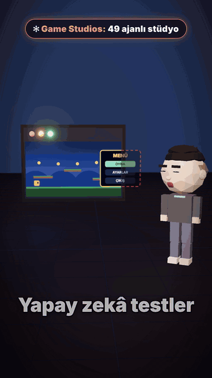

# Claude Code Game Studios: nasıl kullanılır, nasıl ucuza kullanılır



[▶ Videonun tamamı (76 sn): video.mp4](video.mp4)

Videoya yorumda **STÜDYO** yazanlar için. Bu repo Game Studios'un kendisi değil: onun bağlantısı, kurulumu ve **token'ı verimli kullanma rehberiyle bir skill'i**. Game Studios, [Donchitos](https://github.com/Donchitos)'un açık kaynak projesi.

## Bağlantı

🔗 **Claude Code Game Studios:** https://github.com/Donchitos/Claude-Code-Game-Studios

MIT lisans, 49 ajan, 75 skill, 15 hook (deponun README'sine göre; videoda 74 demiştim, depo güncellendi).

## Nasıl başlarsın

```bash
git clone https://github.com/Donchitos/Claude-Code-Game-Studios.git my-game
cd my-game && claude
```

Claude Code açılınca iki yoldan biri:

```
/start
/prototype gece balık tutan, nadir balığın yalnız alacakaranlıkta yem yediği bir oyun
```

`/start` nerede olduğunu sorar (oyun yap, fikrim var, tasarım hazır, mevcut proje) ve seni doğru akışa yönlendirir. `/prototype` bir fikirden tarayıcıda çalışan ilk oyunu çıkarır.

Gerekenler: Git, Claude Code, Python 3, Bash. `/prototype` oyunu açıp ekran görüntüsü almak için Chrome, Edge veya Chromium ister. Claude Code'u **projenin kök klasöründe** aç: `src/` gibi bir alt klasörde başlatırsan deponun hook'ları ve izin kuralları devreye girmez.

## Neler var

- **direktör → lider → uzman:** 3 direktör vizyonu korur, bölüm liderleri alanını yönetir, uzmanlar işi yapar.
- **Godot 4, Unity ve Unreal 5** için ayrı motor uzmanları.
- **Oyun açılıp bakılmadan iş kapanmıyor:** oyuncunun gördüğü bir şey değiştiyse, oyun açılıp ekran görüntüsü `production/qa/evidence/` altına konmadan hikâye kapanmaz.
- **Ajanlar önce soru soruyor, seçenek sunuyor, kararı sen veriyorsun.** Onayın olmadan dosya yazılmıyor.
- **75 komut (skill):** `/start`, `/brainstorm`, `/dev-story`, `/code-review`, `/qa-plan`, `/playtest-report`…
- **15 hook:** commit'te sabit değer, JSON geçerliliği, tasarım belgesi bölümleri denetleniyor.

Geliştiricinin kendi ölçümü: aynı özetten dört oyun yaptırmış. Kodlamadan önce 30 belge yazan `standard` sürüm 58 dakika sürmüş; iki kör değerlendirici ve bir insan oyun testi onu **sonuncu** sıralamış. Bu yüzden varsayılan yol hafif (`minimal`): tek sayfalık bir brief, oynanabilir ilk sürüm, sonra her oturumda bir özellik.

## Videoda anlattığım adımlar

1. Adı Claude Code Game Studios, Claude Code'u 49 ajanlı bir stüdyoya çeviren ücretsiz şablon.
2. Oyuncunun gördüğü bir şey değiştiyse, oyun açılıp ekran görüntüsü saklanmadan iş kapanmıyor.
3. Direktörler vizyonu koruyor, bölüm liderleri alanını yönetiyor, uzmanlar işi yapıyor.
4. Godot, Unity ve Unreal için ayrı motor uzmanları, her aşama için komut var.
5. Ajan önce soru soruyor, seçenek sunuyor, kararı sen veriyorsun, onayın olmadan dosya yazılmıyor.
6. Geliştirici aynı özetten 4 oyun yaptırmış, kodlamadan önce 30 belge yazan sürüm kör değerlendirmede sonuncu çıkmış.
7. Kurmak için repoyu klonlayıp kök klasörde Claude Code'u açıyorsun, sonra başlangıç komutunu yazıyorsun.

---

# Token'ı nereye harcıyor, nasıl azaltırsın

En çok gelen soru: **49 ajan ve 75 skill token'ı patlatmaz mı?** Deponun 10 Kasım 2026'daki hâlini ölçtüm. Ölçümü sen de çalıştırabilirsin: `python3 olcum/olcum.py` (yalnız Python 3 ister, hiçbir şey yazmaz).

| Kalem | Ölçülen | Bağlama ne zaman giriyor |
|---|---|---|
| 49 ajanın açıklamaları | 6.335 karakter, ≈ 1,6 bin token | oturum başında |
| 78 skill dosyasının ad + açıklaması (75 skill + eski adlara yönlendiren 3) | 11.600 karakter, ≈ 2,9 bin token | oturum başında (8'inin açıklaması hiç girmiyor) |
| `CLAUDE.md` | 3.412 karakter, ≈ 0,9 bin token | oturum başında |
| **Boşta toplam** | **≈ 5,3 bin token** | |
| Bir skill'in gövdesi | medyan 12 bin karakter ≈ 3 bin token; en büyüğü ≈ 7 bin (`skill-test`) | **yalnız çağırınca**, sonra konuşmada kalır |
| Bir ajanın gövdesi | en büyüğü ≈ 4,6 bin token (`godot-csharp-specialist`) | **yalnız o ajan çalışınca** |

*(Token tahmini karakter ÷ 4, kabadır.)*

49 ajan aynı anda çalışmıyor: dosya olarak duruyorlar, çağrılınca devreye giriyorlar. Boşta duran hepsinin bedeli birkaç bin token. Asıl harcama dört yerde:

1. **Uzun oturum.** Bağlam her mesajla büyür; aynı oturumda onlarca ilgisiz iş yapmak en pahalı alışkanlık.
2. **Oturum modeli.** 49 ajanın 30'u oturumunun modelini devralıyor. Oturumu Opus'ta tutarsan o 30 ajan da Opus'ta çalışır.
3. **Çok ajanlı komutlar.** `/team-combat`, `/team-ui`, `/team-release`… birkaç ajanı birden çalıştırır, her biri kendi bağlamını açar.
4. **Direktör incelemeleri.** 3 direktör Opus ister; `modes.review_mode` ne kadar sık çağırdıklarını belirler.

Yani "40–50 ajan çalışıyor" değil, **neyi ne kadar sık ve hangi modelle çağırdığın** belirleyici. Güzel tarafı: depo zaten kendi içinde model dağıtıyor (78 skill dosyasının 68'i Sonnet, 6'sı Haiku, 3'ü Opus ister). Senin yapacağın şey, bunun üstüne doğru oturum modelini ve alışkanlığı eklemek.

## Daha az token için 8 kural

1. **Günlük oturumu Sonnet'te tut:** `/model sonnet`. Zor işte `/model opusplan`: plan modunda Opus, uygulamada Sonnet.
2. **Görev bitince `/clear`.** Bedava, sayaç sıfırlanır. Uzun görevde `/compact <ne korunsun>`; neyin yer kapladığını `/context` ile gör.
3. **Hafif yolda kal:** `modes.rigor` varsayılan `minimal`. `standard` ve `full` daha çok belge, daha çok token demek; deponun kendi ölçümünde daha iyi oyun da vermedi.
4. **Direktör incelemesini kişisel olarak kıs:** `/project-settings --local modes.review_mode=solo` (yalnız senin makinende, `project.local.yaml`'a yazar).
5. **`team-*` komutlarını bilinçli kullan.** Küçük işte tek ajanlı komut yeter.
6. **Dosyayı baştan sona okutma.** Önce arama, sonra satır aralığı; uzun çıktıyı dosyaya yazdırıp özet al.
7. **Basit işte efor düşür** (`/effort low`), zor işte yükselt. Çoğu 5.x modelde varsayılan `medium`.
8. **İşi parçala.** Bir iş iki denemede düzelmiyorsa önce böl, sonra model yükselt.

## Basit / orta / zor: hangi iş hangi modele

Takma adlar `haiku`, `sonnet`, `opus`. **Haiku en ucuz ve hızlı, Opus en güçlü ve pahalı, Sonnet ikisinin arası.** Token fiyatları için [Anthropic'in fiyat sayfasına](https://platform.claude.com/docs/en/about-claude/pricing) bak; değiştikleri için buraya yazmadım.

| | **Basit → Haiku** | **Orta → Sonnet** | **Zor → Opus** |
|---|---|---|---|
| **Kod** | arama, yeniden adlandırma, biçimlendirme, tek sabit değer, testi çalıştırıp hataları özetleme | tek özellik, 1–3 dosyalık hata, test yazma, rutin kod incelemesi | mimari, kök nedeni bilinmeyen hata, çok dosyalı değişiklik, güvenlik, performans |
| **Araştırma** | tek sayfa özet, sürüm/lisans/komut bulma | 3–5 kaynağı karşılaştırma, bilinen çözümleri tarama | çelişen çok kaynağı sentezleme, karar önerisi |
| **Tasarım/belge** | şablon doldurma, tutarlılık kontrolü, sürüm notu taslağı | tek sistem belgesi, görev yazımı, sprint planı | çekirdek döngü ve his, ekonomi/denge, kapsam kesme |
| **QA** | testleri koşma, kanıt dosyası var mı | test senaryosu, hata ayıklama | aralıklı (flaky) hata, zamanlama/çok oyunculu hatalar |
| **Metin/ses/sanat** | düzeltme, çeviri tablosu | diyalog, görev metni, mağaza metni | anlatı yapısı, sanat yönergesi, ton |
| **Üretim** | durum raporu, açık iş sayımı | sprint planı, tahmin, retrospektif | kapsam/tarih çatışması, yayın kararı |

Üç soru: *Cevap zaten ortada mı?* → basit. *Birkaç dosya, bilinen kalıp, doğrulayan bir test var mı?* → orta. *Belirsiz, çok sistemli ya da geri dönüşü pahalı mı?* → zor. Birden fazla uyuyorsa yükseğini al. Ayrıntılı tablo ve yükseltme kuralları: [`skills/token-ekonomisi/model-matrisi.md`](skills/token-ekonomisi/model-matrisi.md).

## Alt ajanlar

Alt ajanın **ayrı bağlamı ve ayrı faturası** var. Ham çıktıyı ana konuşmadan uzak tutar ve işi ucuz modele taşır; ama her biri kendi başlangıcını yükler, o yüzden küçük iş için açmak pahalıya gelir.

- **Aç:** çok dosyada arama, uzun test/derleme çıktısı, bağımsız 3+ kaynak taraması, taze gözle inceleme.
- **Açma:** tek dosyalık küçük düzenleme, çıktısı sonrakinin girdisi olan adımlar.
- Paralel alt ajan **hız** içindir, tasarruf için değil.
- Yerleşik **Explore** alt ajanı Haiku değildir; ana oturumun modelini kullanır. Ucuz tarama için kendi ajanını tanımla: [`ajanlar/tarayici.md`](ajanlar/tarayici.md) (`model: haiku`, yalnız okur) ve [`ajanlar/test-kosucu.md`](ajanlar/test-kosucu.md) (testi koşar, yalnız hataları özetler).
- Alt ajan modeli şu sırayla çözülür: Agent çağrısındaki `model` parametresi → ajan dosyasındaki `model:` → `CLAUDE_CODE_SUBAGENT_MODEL` → oturum modeli.

## `token-ekonomisi` skill'ini kur

Skill, Claude'a bu rehberi uygulattırır: işi sınıflar, modeli ve alt ajan kararını tek satırda söyler, bağlamı temiz tutar. Game Studios'a özel kuralları (oturum modeli, `review_mode`, `team-*`) da içerir.

```bash
git clone https://github.com/timhatipoglu/claude-code-game-studios-rehber.git
mkdir -p ~/.claude/skills ~/.claude/agents
cp -r claude-code-game-studios-rehber/skills/token-ekonomisi ~/.claude/skills/
cp claude-code-game-studios-rehber/ajanlar/*.md ~/.claude/agents/
```

Yalnız bir projede kullanmak istersen `~/.claude/` yerine projenin `.claude/` klasörüne kopyala. Sonra Claude Code'da:

```
/token-ekonomisi envanter ekranını sürükle-bırak yap
```

Skill'in kendisi küçük: açıklaması oturum başında yalnız birkaç satır tutar, ayrıntılı tablo (`model-matrisi.md`) sadece gerektiğinde okunur.

## Bu repoda ne var

```
README.md                           bu rehber
demo.gif, video.mp4                 videodan önizleme ve videonun kendisi
skills/token-ekonomisi/SKILL.md     skill (kısa)
skills/token-ekonomisi/model-matrisi.md   iş türüne göre ayrıntılı model tablosu
ajanlar/tarayici.md                 Haiku ile arama ajanı
ajanlar/test-kosucu.md              Haiku ile test çalıştırıp özetleyen ajan
olcum/olcum.py                      yukarıdaki ölçümü yeniden üretir
```

## Kaynaklar

- Claude Code belgeleri: [model ayarları](https://code.claude.com/docs/en/model-config), [alt ajanlar](https://code.claude.com/docs/en/sub-agents), [skill'ler](https://code.claude.com/docs/en/skills), [maliyet](https://code.claude.com/docs/en/costs)
- [Claude Code Game Studios](https://github.com/Donchitos/Claude-Code-Game-Studios): ajanların ve skill'lerin kendisi

Takıldığın yer olursa Instagram'dan yaz, birlikte bakarız.
